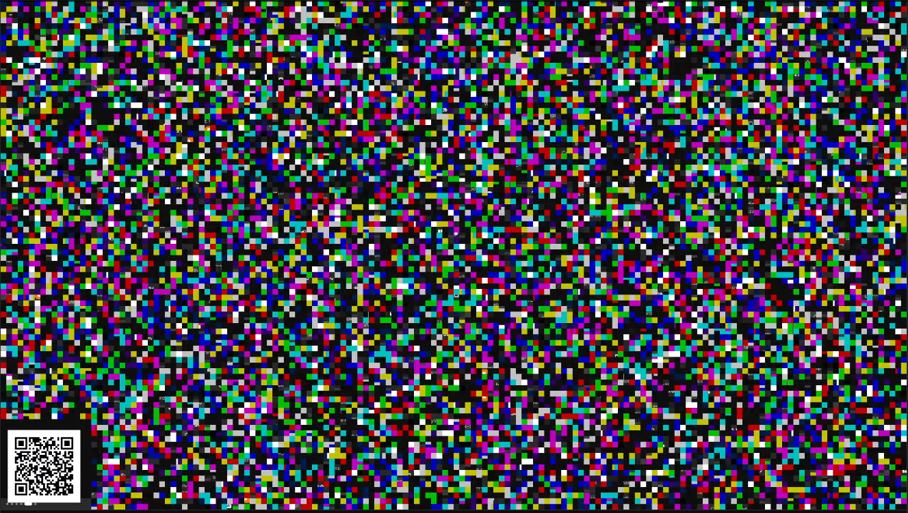
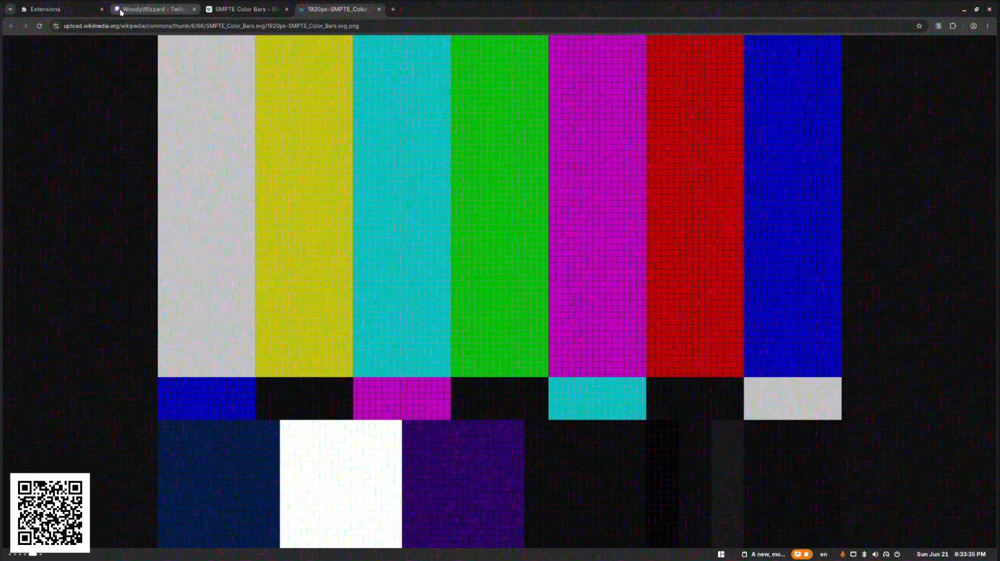

# SecretStream

<!-- support:top:start -->
<p align="center">
  <a href="https://buymeacoffee.com/chamomilewoods"></a>
</p>
<p align="center"><b>☕ Like this project? <a href="https://buymeacoffee.com/chamomilewoods">Support the author on Buy Me a Coffee</a></b></p>
<!-- support:top:end -->

SecretStream is an experimental OBS + browser-extension setup for hiding a live
stream behind deterministic block scrambling.

The streamer runs an OBS video filter that scrambles the frame by key. Viewers
who know the same key can use the browser extension to reconstruct the stream in
real time. The public QR marker in the corner contains only stream geometry
metadata, not the secret key.

Browser Extensions:
- Firefox: https://addons.mozilla.org/en-CA/firefox/addon/secretstream-decoder/
- Chrome: In Progress

## Screenshots

### Encrypted stream



### Decrypted stream



## Components

- `obs-plugin/` - native OBS video filter, currently tested on Linux.
- `extension-chrome/` - Chrome / Chromium Manifest V3 extension.
- `extension-firefox/` - Firefox Manifest V3 extension.
- `web/` - shared browser decoder logic and local test pages.
- `src/` - original TypeScript encoder/decoder experiments and golden tests.

## Build Browser Extensions

```bash
npm install
npm run build:ext
```

Load unpacked:

- Chrome / Chromium: `chrome://extensions` -> Developer mode -> Load unpacked -> `extension-chrome/`
- Firefox: `about:debugging#/runtime/this-firefox` -> Load Temporary Add-on -> `extension-firefox/manifest.json`

## Build OBS Plugin

Fedora example:

```bash
sudo dnf install obs-studio obs-studio-devel cmake gcc qrencode-libs
cd obs-plugin
cmake -B build -S .
cmake --build build
cmake --install build
```

Restart OBS and add the `SecretStream Scramble` video filter to a source.

## Notes

This is stream obfuscation, not a replacement for end-to-end encrypted video
transport. Compression, scaling, and Twitch transcoding can affect recovery
quality, so using Source quality and a stable block grid gives the best result.

<!-- support:bottom:start -->
## ☕ Support the author

If this project is useful to you, you can support the author — it really helps to keep working on it:

**https://buymeacoffee.com/chamomilewoods**

<a href="https://buymeacoffee.com/chamomilewoods"></a>
<!-- support:bottom:end -->
